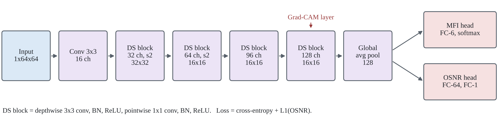

# LiteOPM-Net

**An explainable, lightweight multi-task CNN for joint modulation format identification and OSNR monitoring in coherent optical links.**

Code for the paper:

## Overview

LiteOPM-Net identifies six modulation formats (QPSK, 8PSK, 8QAM, 16QAM, 32QAM, 64QAM) and estimates OSNR from a single 64 × 64 constellation image, using 33.2 k parameters. Grad-CAM, checked with a deletion test and a region analysis, shows that the network reads the format from cluster positions and OSNR from the noise spread around clusters.

The notebook `LiteOPM-Net.ipynb` contains the full pipeline:

- a coherent link simulator (split-step Fourier fibre model, EDFA spans, ASE noise loading, laser phase noise, receiver DSP) with physics checks
- dataset generation: 11,340 constellation images over nine link conditions, OSNR 10–30 dB
- training of LiteOPM-Net and three baselines (AlexNet-style CNN, MobileNetV2, ResNet-18), three seeds each
- Grad-CAM analysis, result tables and figures

## Main results (seen test set, mean ± std over three seeds)

| Model | Parameters | Format accuracy (%) | OSNR MAE (dB) | CPU latency (ms/image) |
|---|---|---|---|---|
| **LiteOPM-Net** | **33.2 k** | 97.5 ± 0.4 | 0.52 ± 0.01 | **0.83** |
| AlexNet-style CNN | 2.50 M | 97.8 ± 0.1 | 0.66 ± 0.14 | 3.70 |
| MobileNetV2 | 2.31 M | 95.5 ± 0.4 | 0.80 ± 0.02 | 3.77 |
| ResNet-18 | 11.21 M | 97.5 ± 0.5 | 0.48 ± 0.01 | 7.99 |

All results are in `results.json` and all figures in `figs/`.

## How to run

1. Download `LiteOPM-Net_dataset.zip` from the [Releases](../../releases) page (or generate the dataset in the notebook by setting `REGENERATE_DATA = True`).
2. Open `LiteOPM-Net.ipynb` in [Google Colab](https://colab.research.google.com) (File → Upload notebook, or open it from GitHub).
3. Choose **Runtime → Change runtime type → T4 GPU**, then **Runtime → Run all**, and upload the dataset zip when asked.

It takes about 45–75 minutes on a free T4 GPU. Requirements outside Colab: Python 3.10+, numpy, scipy, matplotlib, scikit-learn, PyTorch and torchvision.

## Citation

Citation details will be added after publication. See `CITATION.cff`.

## License

MIT License. See `LICENSE`.

## Contact

Dr. Sanskruti Patel, Faculty of Computer Science and Applications, CMPICA, Charotar University of Science and Technology (CHARUSAT), Gujarat, India. E-mail: sanskrutipatel.mca@charusat.ac.in
